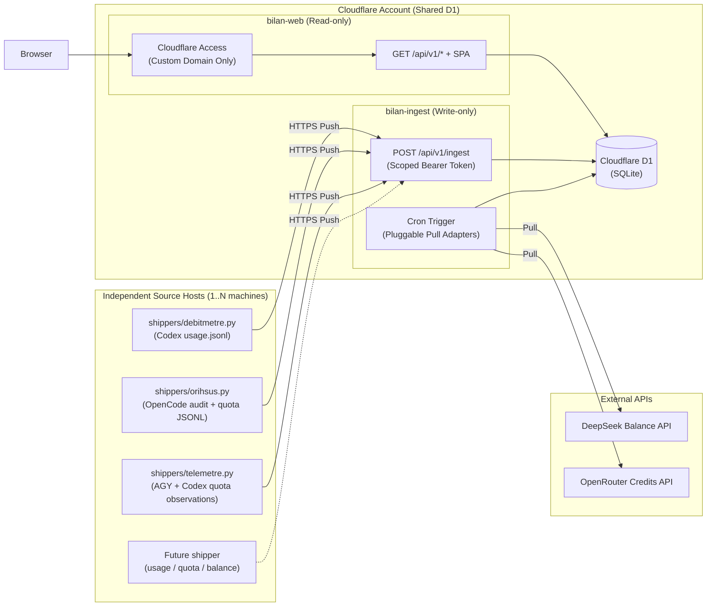

# bilan — Design Specification (v1)

> Status: **accepted (v1)**.
> Principle: **Data first, zero premature complexity.** Get reliable, auditable multi-machine data flowing into D1 and visible on one clean page; do not invent missing metrics, do not display uncollected data as `0`, and do not add new upstream collection tasks.

## 1. Product Positioning & v1 Scope Matrix

`bilan` is a personal AI consumption aggregator and dashboard built on **Cloudflare Workers + D1**.

Upstream tools remain the authoritative collectors (sources of truth) for their respective domains. Each source is integrated **strictly for what it already collects reliably without manual pulling**:

| Platform | Token Usage (`usage_buckets`) | Quota Windows (`quota_observations`) | Balance (`balance_snapshots`) | Transport & Source |
| :--- | :--- | :--- | :--- | :--- |
| **Codex (ChatGPT Pro)** | **Included** (`debitmetre` `usage.jsonl`) | **Included** (`telemetre` Codex quota observations) | N/A | Push (`shippers/debitmetre.py` usage; `shippers/telemetre.py` quota) |
| **OpenCode Go** | **Included** (`orihsus` `audit.jsonl`) | **Included** (`orihsus` `usage/YYYY-MM-DD.jsonl`) | N/A | Push (`shippers/orihsus.py`) |
| **Antigravity (AGY)** | **Deferred** (currently requires manual pull; **never shown as `0`**) | **Included** (`telemetre` AGY quota observations) | N/A | Push (`shippers/telemetre.py`) |
| **OpenRouter** | N/A | N/A | **Included** (`/api/v1/credits`) | Pull (Worker Cron) |
| **DeepSeek** | N/A | N/A | **Included** (`/user/balance`) | Pull (Worker Cron) |

### v1 Scope (Included)

1. **Read/Write Split across two Workers sharing one D1 database**:
   - **Ingest Worker (`bilan-ingest`)**: owns all writes — unified Push API (`POST /api/v1/ingest`) + Cron Pull adapters (OpenRouter, DeepSeek).
   - **Web/Read Worker (`bilan-web`)**: owns all reads — static dashboard UI (Workers Assets) + read-only query API (`GET /api/v1/*`), protected end-to-end by **Cloudflare Access (Zero Trust)** with `workers_dev = false` and `preview_urls = false`.
2. **Normalized D1 storage** for 3 orthogonal telemetry kinds (`usage_buckets`, `quota_observations` + `quota_windows`, `balance_snapshots`) plus producer liveness (`producers`).
3. **In-repo shipper scripts** (`shippers/`) for `debitmetre` (Codex token usage), `orihsus` (OpenCode Go token usage + quota), and `telemetre` (AGY & Codex quota observations) that run independently on any host.
4. **Minimal, data-first dashboard** showing OpenRouter/DeepSeek balances, AGY / Codex / OpenCode Go quota windows + reset times, Codex & OpenCode Go periodic token usage summaries, and explicit shipper liveness vs. data freshness.

### Explicit Non-Goals (Deferred Until After Real Usage)

- AGY token usage ingestion or mutable-event range-revocation protocols (deferred while AGY token collection is manual).
- Acting as an LLM proxy or touching live inference traffic.
- Storing per-request raw logs, prompts, message bodies, tool arguments, or raw upstream credentials.
- Assuming upstream collectors share one host (they may coexist today and split across hosts tomorrow).
- Built-in user login/session management (delegated entirely to Cloudflare Access).
- Subscription cost ledger UI, automated equivalent-API-cost pricing engine, alerting webhooks, or complex BI charts (deferred to v2 once v1 data is verified in daily use).

---

## 2. System Architecture (Read/Write Split)



### Key Architectural Guarantees & Boundaries

1. **Clean Security & Auth Boundary**:
   - `bilan-web` sits exclusively behind **Cloudflare Access** on a custom domain (`workers_dev = false`, `preview_urls = false`). It has zero write endpoints and zero upstream/ingest secrets.
   - `bilan-ingest` exposes only `POST /api/v1/ingest` (authenticated via per-producer scoped Bearer tokens) and holds pull secrets (`OPENROUTER_API_KEY`, `DEEPSEEK_API_KEY`, `INGEST_PRODUCERS_JSON`). It exposes zero read/UI endpoints.
2. **Logical Dataset Identity (`producer_id`)**:
   - `producer_id` identifies a **logical dataset or shard** (e.g., `debitmetre-main`, `orihsus-main`, `telemetre-quota`, `pull-openrouter`, `pull-deepseek`), **NOT** a physical hostname.
   - When migrating a collector/gateway to another VPS, **retain the same `producer_id`** (and move/rotate its token) so historical data is never double-counted.
   - Multiple `producer_id`s for the same `source` are summed in queries **only** when they represent genuinely disjoint shards (e.g., two independent gateway instances serving non-overlapping traffic).
3. **Single-Writer Serial ACK & Out-of-Order Retry Protection**:
   - Each `producer_id` has a single active writer (enforced locally via lockfile / systemd single-instance timer), sending one batch at a time and advancing its local cursor/watermark only after receiving HTTP `200`.
   - Every push carries a **persisted monotonically increasing integer `batch_seq`** (`1, 2, 3, ...`; never wall-clock time). On timeout/transient failure, the shipper retries the **exact same payload with the same `batch_seq`**.
   - `bilan-ingest` checks `batch_seq` against `producers.last_batch_seq`: `batch_seq < last_batch_seq` returns `409 Conflict` (no writes); `batch_seq == last_batch_seq` returns `200` no-op ACK (no rewrites); `batch_seq > last_batch_seq` commits data and updates `producers.last_batch_seq` **atomically in the same D1 `batch()`**.
4. **Simple Idempotent Upsert for Append-Only Usage Sources**:
   - Because v1 `usage_buckets` come exclusively from append-only gateway logs (`debitmetre` and `orihsus`), completed or active UTC hour buckets are monotonically updated via idempotent `INSERT ... ON CONFLICT DO UPDATE` (guarded by `batch_seq`). No complex mutable-event range-revocation protocol is needed in v1.
5. **Symmetric Push & Pull Data Contract**:
   - Both Push shippers and Worker Pull adapters write into the exact same normalized D1 tables.

---

## 3. Accounting, Semantics & Freshness Rules

Inherited from `debitmetre`, `orihsus`, and `telemetre`:

1. **Uncollected Metrics Stay Absent (Never `0`)**:
   - AGY has quota windows in v1 and **no** token usage collection; the UI shows AGY quota cards only and never renders an AGY token total of `0`.
2. **Actor & Unit Semantics (No False Equivalence)**:
   - **`actor_id` is NOT always a physical machine**: `debitmetre` emits machine aliases (`actor_kind = 'machine'`), whereas `orihsus` emits `gateway_key` caller identity names (`actor_kind = 'identity'`). Queries and UI label the dimension per source rather than calling `gateway_key` a machine.
   - **Unit counts**: v1 usage sources (`debitmetre`, `orihsus`) both count HTTP requests (`unit_kind = 'request'`); keeping `unit_kind` explicit prevents future non-request sources (e.g., steps) from ever being summed with HTTP requests.
3. **Token Column Semantics & Completeness**:
   - Keep `NULL` (column not reported by source) strictly distinct from `0` (explicitly zero).
   - Never fabricate a cross-column "total tokens" by summing incompatible bases, and never sum token columns across different `(source, accounting_basis)` combinations.
   - **Partial-missing guard**: every bucket stores both `unit_count` and per-column measured counts (`input_counted`, `cached_counted`, `uncached_counted`, `cache_write_counted`, `output_counted`, `reasoning_counted`) plus `coverage_gaps` (units missing expected token fields). When `SUM(col_counted) < SUM(unit_count)` or `SUM(coverage_gaps) > 0`, the API and UI **must** mark that sum as **partial (incomplete)** rather than presenting it as a complete total.
4. **Quota Snapshot Integrity**:
   - Shippers push **all unsent periodic observations** (including backlog accumulated during offline periods) so D1 retains sampling history.
   - **Per-subject grouping & no ghost windows**: each independently sampled subject is grouped by `(source, account)` — for `orihsus`, `account` maps to each upstream key's `key_fingerprint` so independently polled keys do not hide one another. The "current quota" view for each `(source, account)` reads windows exclusively from the **single latest `status = 'ok' AND time_anomaly IS NULL` observation** (by `sampled_at DESC, ingested_at DESC`). Windows that disappeared in the latest valid sample vanish immediately.
   - **Failures, empty samples & future-clock protection**: failed (`error`) or `empty` observations and `time_anomaly` flags from `telemetre` are stored explicitly in `quota_observations` and never converted into numeric readings (`0%` / `100%`). Latest-attempt status and data freshness exclude future-anomalous clocks (`time_anomaly IS NOT NULL` or `sampled_at` beyond allowed skew past `ingested_at`) from winning `MAX(sampled_at)`, and surface anomalous observations separately as explicit warnings so a bad future clock cannot permanently poison freshness.
5. **Shipper Liveness ≠ Data Freshness**:
   - Idle shippers may send an empty heartbeat (`usage_buckets: []`, etc.) to update `producers.last_heartbeat_at` and prove the timer/host is alive.
   - **Data freshness is derived strictly from the data's own timestamps** (`MAX(quota_observations.sampled_at)`, `MAX(balance_snapshots.sampled_at)`, `MAX(usage_buckets.bucket_start)`). Uploading historical backfill or sending a heartbeat **never** makes stale quota/balance/usage data appear fresh.
6. **Balance Delta Semantics**:
   - For balance-only snapshots (e.g., DeepSeek `/user/balance`), `balance(t2) - balance(t1)` mixes top-ups and usage and must be labeled strictly as **Net Balance Change (`net_delta`)**, never as "spend" or "burn".
   - Only when a provider reports a monotonic `cumulative_usage` field (e.g., OpenRouter `total_usage`) may `cumulative_usage(t2) - cumulative_usage(t1)` be labeled **Reported Usage Delta** (flagged if a discontinuity/decrease is observed).
7. **UTC Storage & Timezone Slicing**:
   - All stored timestamps are UTC ISO-8601 (`YYYY-MM-DDTHH:MM:SSZ`).
   - Hourly UTC buckets (`YYYY-MM-DDTHH:00:00Z`) provide exact calendar day/month boundaries for whole-hour UTC offsets (e.g., `UTC`, `Asia/Shanghai` UTC+8) and hour-aligned boundaries for DST zones.

---

## 4. D1 Data Model (v1 — 5 Core Tables)

### 4.1 `producers` (Registry, Liveness & Replay Guard)

```sql
CREATE TABLE producers (
  producer_id               TEXT PRIMARY KEY, -- logical dataset ID: 'debitmetre-main', 'orihsus-main', 'telemetre-quota', 'pull-openrouter', 'pull-deepseek'
  mode                      TEXT NOT NULL,    -- 'push' | 'pull'
  display_name              TEXT NOT NULL,
  scopes_json               TEXT NOT NULL,    -- JSON array of {"source": "...", "kind": "..."}
  expected_interval_seconds INTEGER NOT NULL DEFAULT 3600,
  last_batch_seq            INTEGER NOT NULL DEFAULT 0, -- monotonic guard for push producers
  last_heartbeat_at         TEXT,             -- UTC ISO-8601 of last successful push/heartbeat/pull
  last_attempt_at           TEXT,             -- UTC ISO-8601 of last attempt (ok or error)
  last_status               TEXT,             -- 'ok' | 'error'
  last_error                TEXT,             -- sanitized, bounded error summary (never secrets)
  updated_at                TEXT NOT NULL
);
```

### 4.2 `usage_buckets` (Periodic Token Usage Facts)

```sql
CREATE TABLE usage_buckets (
  producer_id         TEXT NOT NULL,
  source              TEXT NOT NULL,          -- 'codex' | 'opencode' | ...
  account             TEXT NOT NULL DEFAULT 'default',
  actor_kind          TEXT NOT NULL,          -- 'machine' (debitmetre) | 'identity' (orihsus gateway_key)
  actor_id            TEXT NOT NULL DEFAULT 'unknown',
  model               TEXT NOT NULL DEFAULT 'unknown',
  effort              TEXT NOT NULL DEFAULT '', -- debitmetre declared reasoning effort; '' if n/a
  bucket_start        TEXT NOT NULL,          -- UTC hour start: 'YYYY-MM-DDTHH:00:00Z'

  unit_kind           TEXT NOT NULL,          -- 'request' (v1) | 'step' (future)
  unit_count          INTEGER NOT NULL DEFAULT 0,
  coverage_gaps       INTEGER NOT NULL DEFAULT 0, -- units missing expected token counts

  -- Nullable sums: NULL = column not reported by source, 0 = explicitly zero
  -- *_counted: how many units in unit_count contributed a non-null value for that column
  input_tokens        INTEGER,
  input_counted       INTEGER NOT NULL DEFAULT 0,
  cached_tokens       INTEGER,                -- cache_read_tokens / prompt_cache_hit_tokens
  cached_counted      INTEGER NOT NULL DEFAULT 0,
  uncached_tokens     INTEGER,
  uncached_counted    INTEGER NOT NULL DEFAULT 0,
  cache_write_tokens  INTEGER,
  cache_write_counted INTEGER NOT NULL DEFAULT 0,
  output_tokens       INTEGER,
  output_counted      INTEGER NOT NULL DEFAULT 0,
  reasoning_tokens    INTEGER,
  reasoning_counted   INTEGER NOT NULL DEFAULT 0,

  accounting_basis    TEXT NOT NULL DEFAULT 'unknown',
  source_version      TEXT NOT NULL DEFAULT 'unknown',
  batch_seq           INTEGER NOT NULL DEFAULT 0,
  updated_at          TEXT NOT NULL,

  PRIMARY KEY (producer_id, source, account, actor_kind, actor_id, model, effort, bucket_start)
);

CREATE INDEX idx_usage_buckets_time ON usage_buckets (bucket_start, source);
CREATE INDEX idx_usage_buckets_source_time ON usage_buckets (source, bucket_start);
```

### 4.3 `quota_observations` & `quota_windows` (Atomic Quota Samples)

Split into observation header + child windows so failed/empty samples, `time_anomaly`, and window disappearances are represented faithfully.

```sql
CREATE TABLE quota_observations (
  producer_id      TEXT NOT NULL,
  sample_id        TEXT NOT NULL,             -- stable source sample ID (telemetre sample_id or deterministic orihsus poll key)
  source           TEXT NOT NULL,             -- 'agy' | 'codex' | 'opencode' | ...
  account          TEXT NOT NULL DEFAULT 'default',
  observer_machine TEXT NOT NULL DEFAULT 'unknown', -- host that performed the quota sample
  sampled_at       TEXT NOT NULL,             -- UTC ISO-8601
  interval_seconds INTEGER,                   -- configured sampling interval for staleness calculation
  status           TEXT NOT NULL,             -- 'ok' | 'empty' | 'error'
  time_anomaly     TEXT,                      -- NULL or sanitized anomaly code/list from telemetre
  error_summary    TEXT,                      -- NULL or sanitized short error when status = 'error'
  ingested_at      TEXT NOT NULL,

  PRIMARY KEY (producer_id, sample_id)
);

CREATE INDEX idx_quota_obs_latest ON quota_observations (source, account, sampled_at DESC);

CREATE TABLE quota_windows (
  producer_id          TEXT NOT NULL,
  sample_id            TEXT NOT NULL,
  bucket_id            TEXT NOT NULL,         -- telemetre bucket_id (AGY model group / Codex limit_id) or orihsus key_fingerprint
  slot                 TEXT NOT NULL,         -- telemetre slot (e.g. '5h', 'weekly', 'primary'/'secondary') or orihsus ('rolling', 'weekly', 'monthly')
  label                TEXT,                  -- optional display alias (e.g. orihsus key name, AGY/Codex bucket label)
  used_percent         REAL,                  -- 0..100, NULL if not reported
  remaining_percent    REAL,                  -- 0..100, NULL if not reported
  status               TEXT,                  -- 'ok' | 'limited' | 'cooldown' | 'unknown'
  resets_at            TEXT,                  -- UTC ISO-8601 or NULL
  window_duration_mins INTEGER,
  meta_json            TEXT,                  -- small bounded JSON for non-sensitive metadata

  PRIMARY KEY (producer_id, sample_id, bucket_id, slot),
  FOREIGN KEY (producer_id, sample_id) REFERENCES quota_observations (producer_id, sample_id) ON DELETE CASCADE
);
```

### 4.4 `balance_snapshots` (Prepaid API Platform Balances)

```sql
CREATE TABLE balance_snapshots (
  producer_id       TEXT NOT NULL,
  provider          TEXT NOT NULL,            -- 'openrouter' | 'deepseek' | ...
  account           TEXT NOT NULL DEFAULT 'default',
  currency          TEXT NOT NULL,            -- 'USD' | 'CNY' | ...
  sampled_at        TEXT NOT NULL,            -- UTC ISO-8601

  total_balance     REAL,                     -- Remaining available balance
  topped_up_balance REAL,                     -- Paid/recharged portion if reported
  granted_balance   REAL,                     -- Free/promotional portion if reported
  cumulative_usage  REAL,                     -- Monotonic cumulative spend if reported (OpenRouter total_usage)
  credit_limit      REAL,                     -- Total purchased credits / cap if reported
  is_available      INTEGER,                  -- 1/0 boolean if reported
  ingested_at       TEXT NOT NULL,

  PRIMARY KEY (producer_id, provider, account, currency, sampled_at)
);

CREATE INDEX idx_balance_latest ON balance_snapshots (provider, account, currency, sampled_at DESC);
```

---

## 5. Flexible Push & Pull Interfaces

### 5.1 Unified Push API (`POST /api/v1/ingest` on `bilan-ingest`)

Every request is authenticated by `Authorization: Bearer <token>`. The Worker resolves `producer_id` and its exact allowed `(source, kind)` tuples from `INGEST_PRODUCERS_JSON` (never trusting a `producer_id` from the request body).

#### Authorization Model (Explicit Scopes, No Cartesian Product)

Each producer config specifies explicit `(source, kind)` scope pairs:

```json
{
  "debitmetre-main": {
    "token_sha256": "...",
    "display_name": "debitmetre (Codex usage)",
    "expected_interval_seconds": 3600,
    "scopes": [
      { "source": "codex", "kind": "usage_buckets" }
    ]
  },
  "orihsus-main": {
    "token_sha256": "...",
    "display_name": "orihsus (OpenCode Go)",
    "expected_interval_seconds": 1800,
    "scopes": [
      { "source": "opencode", "kind": "usage_buckets" },
      { "source": "opencode", "kind": "quota_observations" }
    ]
  },
  "telemetre-quota": {
    "token_sha256": "...",
    "display_name": "telemetre (AGY + Codex quota)",
    "expected_interval_seconds": 1800,
    "scopes": [
      { "source": "agy", "kind": "quota_observations" },
      { "source": "codex", "kind": "quota_observations" }
    ]
  }
}
```

With explicit `(source, kind)` tuples, `telemetre-quota` can write `(codex, quota_observations)` without being authorized to write `(codex, usage_buckets)` (which belongs exclusively to `debitmetre-main`).

#### Request Envelope (`schema_version: 1`, `orihsus-main` example)

```json
{
  "schema_version": 1,
  "batch_seq": 42,
  "usage_buckets": [
    {
      "source": "opencode",
      "account": "default",
      "actor_kind": "identity",
      "actor_id": "laptop-key",
      "model": "deepseek-reasoner",
      "effort": "",
      "bucket_start": "2026-11-26T14:00:00Z",
      "unit_kind": "request",
      "unit_count": 18,
      "coverage_gaps": 0,
      "input_tokens": 120000,
      "input_counted": 18,
      "cached_tokens": 80000,
      "cached_counted": 18,
      "uncached_tokens": 40000,
      "uncached_counted": 18,
      "cache_write_tokens": null,
      "cache_write_counted": 0,
      "output_tokens": 9500,
      "output_counted": 18,
      "reasoning_tokens": 4200,
      "reasoning_counted": 18,
      "accounting_basis": "orihsus-audit-v1",
      "source_version": "0.1.0"
    }
  ],
  "quota_observations": [
    {
      "sample_id": "opencode:a1b2c3d4e5f6:2026-11-26T14:30:00Z",
      "source": "opencode",
      "account": "a1b2c3d4e5f6",
      "observer_machine": "gateway-1",
      "sampled_at": "2026-11-26T14:30:00Z",
      "interval_seconds": 300,
      "status": "ok",
      "time_anomaly": null,
      "error_summary": null,
      "windows": [
        {
          "bucket_id": "a1b2c3d4e5f6",
          "slot": "weekly",
          "label": "go-key-1",
          "used_percent": 42.5,
          "remaining_percent": 57.5,
          "status": "ok",
          "resets_at": "2026-12-01T00:00:00Z",
          "window_duration_mins": 10080
        }
      ]
    }
  ],
  "balance_snapshots": []
}
```

#### Contract & Guardrails

1. **Idempotent Usage Upsert (`usage_buckets`)**:
   - `INSERT ... ON CONFLICT(...) DO UPDATE ... WHERE excluded.batch_seq >= usage_buckets.batch_seq`.
   - Shippers re-aggregate the complete UTC hour(s) touched since the last watermark (from append-only JSONL) and push full bucket values for those hours.
2. **Heartbeat Support**:
   - An envelope with empty `usage_buckets`, `quota_observations`, and `balance_snapshots` is valid and updates only `producers.last_heartbeat_at`, `last_attempt_at`, `last_status = 'ok'`, and `last_batch_seq`.
3. **Replay & Ordering Guard (Atomic with Data)**:
   - `batch_seq` is a persisted monotonic positive integer (`1, 2, 3, ...`) maintained per producer; on failure the shipper retries the exact same batch with the same `batch_seq`.
   - `batch_seq < producers.last_batch_seq` → `409 Conflict` (stale retry, no writes).
   - `batch_seq == producers.last_batch_seq` → `200 OK` no-op ACK (no rewrites).
   - `batch_seq > producers.last_batch_seq` → data writes and `producers.last_batch_seq` update commit **atomically in the same D1 `batch()`**.
4. **Quota & Balance Idempotency**:
   - `quota_observations`: `INSERT ... ON CONFLICT(producer_id, sample_id) DO NOTHING` (observations are immutable once sampled; windows inserted for newly accepted observations).
   - `balance_snapshots`: `INSERT ... ON CONFLICT DO UPDATE` by `(producer_id, provider, account, currency, sampled_at)`.
5. **Bounded Payload & Strict Validation**:
   - Max 500 total rows (buckets + observations + windows + balances) and 512 KiB request body.
   - Rejects unknown `schema_version`, unauthorized `(source, kind)` scope (`403`), negative counts, `*_counted > unit_count`, percentages outside `[0, 100]`, non-hour-aligned `bucket_start`, or malformed UTC timestamps (`400`).

### 5.2 In-Repo Shippers (`shippers/`)

Python 3 stdlib scripts (zero external dependencies), single-instance locked (`flock` / lockfile), persisting the in-flight batch + monotonic `batch_seq` so retries resend the identical batch and advance the local cursor only after HTTP `200` ACK:

| Shipper | Local Source | Shipped Scopes | Mapping Notes |
| :--- | :--- | :--- | :--- |
| `shippers/debitmetre.py` | `usage.jsonl` | `(codex, usage_buckets)` | `actor_kind='machine'`, `unit_kind='request'`. Aggregates touched UTC hours by `(machine_id, model, effort)` with per-column `*_counted` and `coverage_gaps`; supports `--backfill`. |
| `shippers/orihsus.py` | `audit.jsonl` + `usage/YYYY-MM-DD.jsonl` | `(opencode, usage_buckets)`, `(opencode, quota_observations)` | `actor_kind='identity'` (`gateway_key`), `unit_kind='request'`. Each key poll maps to a `quota_observation` with `account = key_fingerprint`, `bucket_id = key_fingerprint`, `label = key_alias`, `slot = rolling/weekly/monthly`. |
| `shippers/telemetre.py` | `telemetre` centre quota SQLite | `(agy, quota_observations)`, `(codex, quota_observations)` | Reads both `provider IN ('agy', 'codex')` quota observations only (no AGY token usage). Uses centre insertion-order cursor (`rowid` / `received_at`) or bounded idempotent rescan (never a single `sampled_after` timestamp cursor, which would drop late-arriving older `sampled_at` or same-second samples). Maps `provider` → `source`, `account` → `account`, `bucket_id` (AGY model group / Codex `limit_id`) & `slot` (e.g. `5h`/`weekly`) → `quota_windows.(bucket_id, slot)`. Ships all unsent observations including `error`/`empty`/`time_anomaly`. |

### 5.3 Pluggable Worker Pull Adapters (`scheduled` Cron on `bilan-ingest`)

```ts
export interface PullAdapter {
  readonly producerId: string;
  readonly provider: string;
  readonly enabled: (env: Env) => boolean;
  pull(env: Env, nowIso: string): Promise<{
    balanceSnapshots?: BalanceSnapshotInput[];
    quotaObservations?: QuotaObservationInput[];
  }>;
}
```

- Runs on a Worker Cron schedule (e.g., `*/30 * * * *`).
- Each enabled adapter runs under `Promise.allSettled`: one upstream failure never blocks others; failures update `producers.last_attempt_at`, `last_status = 'error'`, and a sanitized `last_error`.
- **v1 Adapters**:
  1. `pull-openrouter`: `GET https://openrouter.ai/api/v1/credits` (secret `OPENROUTER_API_KEY`) → `balance_snapshots` (`USD`, `credit_limit = total_credits`, `cumulative_usage = total_usage`, `total_balance = total_credits - total_usage`).
  2. `pull-deepseek`: `GET https://api.deepseek.com/user/balance` (secret `DEEPSEEK_API_KEY`) → one `balance_snapshots` row per `balance_infos` entry (`CNY` / `USD`, `total_balance`, `topped_up_balance`, `granted_balance`, `is_available`).

---

## 6. Tech Stack & Tooling

Architectural stack decisions are fixed here so implementation stays consistent across all slices:

- **Monorepo & Package Manager**: `pnpm` workspaces + TypeScript (`strict`).
- **Workers Runtime & Routing**: Cloudflare Workers + D1 (`wrangler`), routed with **Hono**.
- **Frontend (`bilan-web`, served via Workers Assets)**:
  - **React + TypeScript + Vite**
  - **Tailwind CSS** + **shadcn/ui** (Radix UI primitives) + **lucide-react** icons
  - **Recharts** for balance history and daily usage trend charts
- **Formatting, Linting & Testing (JS/TS)**:
  - **oxfmt** (formatter)
  - **oxlint** with Cloudflare's official preset (**`@cloudflare/oxlint-config`**)
  - **Vitest** (with `@cloudflare/vitest-pool-workers` for local Miniflare/D1 integration tests)
- **Host Shippers (`shippers/`)**: Python 3 standard library only (zero third-party runtime dependencies), tested with `unittest`.

---

## 7. Repository Layout (Proposed)

```text
bilan/
├── docs/
│   ├── DESIGN.md
│   └── TASKS.md
├── migrations/
│   └── 0001_initial.sql
├── packages/
│   └── shared/                 # Shared TypeScript types, schema validation, SQL helpers
├── workers/
│   ├── ingest/                 # bilan-ingest (Hono POST /api/v1/ingest + Cron pullers)
│   └── web/                    # bilan-web (Hono GET /api/v1/* + Vite/React/shadcn SPA built for Workers Assets)
└── shippers/                   # Standalone Python 3 stdlib shippers for source hosts
    ├── common.py               # Shared HTTPS push client, lockfile, batch_seq, retry
    ├── debitmetre.py
    ├── orihsus.py
    └── telemetre.py
```

---

## 8. Minimal v1 Read APIs & Dashboard (`bilan-web`)

Keep v1 focused strictly on **seeing real, accurate data clearly** (zero manual-pull dependencies):

### Read Endpoints
- `GET /api/v1/overview?tz=Asia/Shanghai&month=2026-11`:
  - **Producer Liveness**: `producers` list (`last_heartbeat_at`, `last_status`, `last_error`, stale indicator).
  - **Balances**: latest `balance_snapshots` per `(provider, account, currency)` with `sampled_at` age, 7d/30d **Net Balance Change (`net_delta`)**, and (where available, e.g. OpenRouter) **Reported Usage Delta**.
  - **Quotas** (AGY, Codex & OpenCode Go): for each `(source, account)` (where `orihsus` uses `account = key_fingerprint`, and `telemetre` uses configured account aliases for `agy` and `codex`), windows from the **single latest `status = 'ok' AND time_anomaly IS NULL` observation** (with `resets_at` & `sampled_at` age), plus the latest non-future-anomalous attempt status/error and any `time_anomaly` warnings surfaced separately.
  - **Monthly Usage** (Codex & OpenCode Go): totals grouped by `(source, accounting_basis, actor_kind, actor_id, model, effort)` with separate token columns, `unit_kind`, `unit_count`, `coverage_gaps`, and per-column completeness flags (`is_partial`). Uncollected sources (AGY) are omitted, never returned as `0`.
- `GET /api/v1/usage/daily?tz=Asia/Shanghai&month=2026-11`:
  - Daily aggregated rows per source for simple trend display (never summing across incompatible `accounting_basis` or `unit_kind`).
- `GET /api/v1/balances/history?provider=openrouter&days=30`:
  - Balance time-series for sparklines/tables.

### Minimal v1 Page Sections
1. **Health Strip**: Producer liveness (`last_heartbeat_at` / errors) clearly distinguished from each data source's own `sampled_at` / `bucket_start` freshness.
2. **Balances & Quotas**:
   - OpenRouter & DeepSeek current balances (+ Net Balance Change; + Reported Usage Delta for OpenRouter).
   - **AGY**, **Codex**, and **OpenCode Go** quota windows from the latest valid observation + reset countdowns + warning badge if the latest attempt failed, returned empty, or had `time_anomaly`.
3. **Token Usage Summary (Month / Timezone switchable)**:
   - **Codex** (`debitmetre`, by machine/model/effort) & **OpenCode Go** (`orihsus`, by identity/model) breakdown tables with separate token columns, explicit partial/coverage-gap badges, and a daily view.
   - AGY token usage is not shown (and never displayed as `0`).

---

## 9. Privacy & Security Checklist

- `bilan-web`:
  - `workers_dev = false` and `preview_urls = false` in `wrangler.toml`.
  - Served exclusively on a custom domain protected by **Cloudflare Access (Zero Trust)**.
  - Holds **zero** write routes and **zero** upstream/ingest secrets.
- `bilan-ingest`:
  - Exposes **zero** read/UI routes.
  - Every push token is hashed (SHA-256), constant-time compared, mapped to a single logical `producer_id`, and restricted to explicit `(source, kind)` scope tuples.
- No prompts, conversation text, file paths, raw upstream API keys, or OAuth tokens are accepted or stored.
- Operational errors written to `producers.last_error` and `quota_observations.error_summary` are sanitized and bounded in length so secrets or upstream response bodies never leak into D1.
