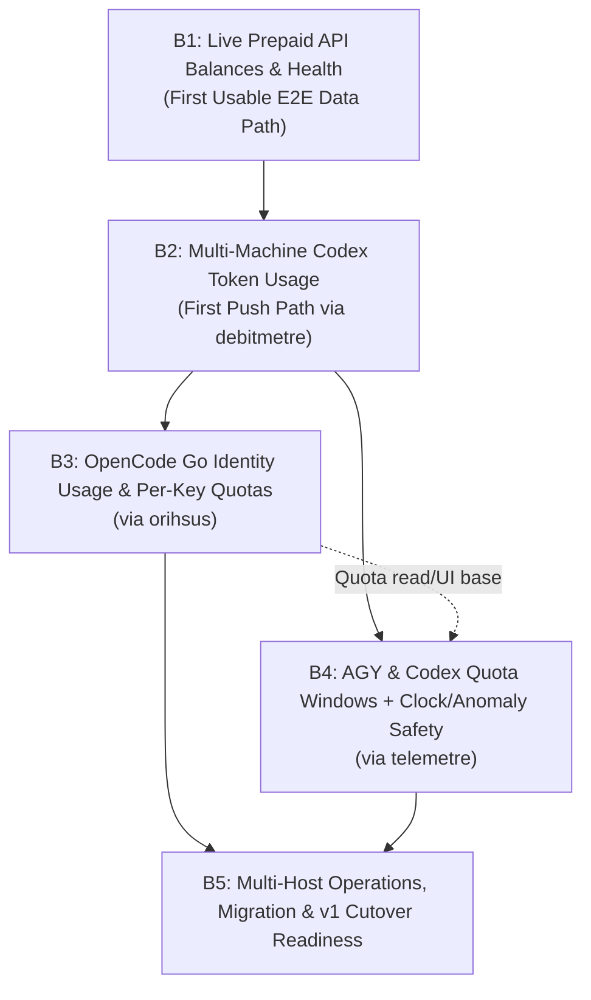

# bilan — v1 Behavior Task Plan

> Canonical specification: [docs/DESIGN.md](DESIGN.md) (accepted v1).
> Framing standard: `write-behavior-task`, retaining explicit **Goal** and **Non-goals** per task.
> Scope: Strictly v1. Planning only — no implementation or production deployment is performed by this document.

---

## Execution Order & Parallelism

1. **Stage 1 — Earliest usable data path**: **B1** delivers the first live end-to-end pipeline (`OpenRouter / DeepSeek → D1 → Read Web Page`) without waiting on any host shipper.
2. **Stage 2 — First real Push caller**: **B2** proves the unified Push ingest seam end-to-end with a real caller (`debitmetre`), avoiding speculative abstractions before a caller exists.
3. **Stage 3 — Parallelizable vertical outcomes**:
   - **B3** (`orihsus` usage + per-key quota read/UI) can run immediately after **B2**.
   - **B4** (`telemetre` AGY + Codex quota ingestion) can develop its host-side collection/push behavior in parallel with **B3**, then integrate anomaly/future-clock display onto **B3**'s quota read/UI surface.
4. **Stage 4 — Full v1 operational readiness**: **B5** verifies multi-host operation, host migration invariance, and security boundaries across all 5 v1 platforms.

> **Owner freedom**: Each outcome owner is free to create or refactor any internal layer needed to deliver the behavior coherently. Any paths mentioned below are expected entry paths or navigation hints, not writable-scope restrictions; the only hard boundaries are security/permission boundaries (e.g., never putting write routes or upstream secrets into the read Worker, never modifying upstream repos `debitmetre`/`orihsus`/`telemetre`) and the locked architectural stack in [docs/DESIGN.md §6](DESIGN.md#6-tech-stack--tooling).

---

## B1 — Live Prepaid API Balances & Producer Health (First Usable Data Path)

* **Dependencies**: None (highest eligible work — establishes the first live end-to-end data path across both Workers and shared D1 with zero host-shipper dependencies).
* **Goal / Outcome**:
  - **Actor / Caller**: Operator opening the read-only web dashboard behind Cloudflare Access, and the scheduled background puller querying OpenRouter and DeepSeek.
  - **Behavior & Observable Result**: On a schedule, OpenRouter and DeepSeek balance snapshots are pulled into shared D1 with per-provider failure isolation; when the operator opens the web page, they immediately see producer liveness vs. balance data freshness, current remaining balances per provider/currency, DeepSeek's 7d/30d net balance change (never mislabeled as spend/burn), OpenRouter's reported usage delta, and balance history—while the read surface exposes zero write routes, holds zero upstream secrets, and disables `workers.dev` and preview URLs.
* **Authority**:
  - Canonical design: [docs/DESIGN.md](DESIGN.md) (§1–§4, §5.3, §6, §8–§9) and user decisions (two-Worker read/write split, CF Access on read surface, OpenRouter & DeepSeek keys in write-Worker Secrets, locked Tech Stack & Tooling in §6).
  - **Permitted external effects**: Local D1/Miniflare runs and synthetic/mocked upstream HTTP tests.
  - **Requires new authority**: Production Cloudflare deployment, provisioning live API keys, or adding pull providers beyond OpenRouter and DeepSeek.
* **Current contract**:
  - Follow all v1 invariants in [docs/DESIGN.md](DESIGN.md): read/write Worker separation (§2, §9), `workers_dev = false` and `preview_urls = false` on the read Worker (§9), fixed tech stack & tooling (`React + TypeScript + Vite + Tailwind CSS + shadcn/ui + lucide-react + Recharts`, `Hono`, `pnpm`, `Vitest`, `oxfmt`, `oxlint` with `@cloudflare/oxlint-config`, §6), balance delta semantics (§3.6), liveness vs. data freshness separation (§3.5), and sanitized/bounded error recording (§9).
* **Non-goals**:
  - No Push ingest endpoint or host shippers (`debitmetre`, `orihsus`, `telemetre`) — those are independent outcomes (B2–B4).
  - No token usage or quota window sections on the page yet.
  - No built-in login UI, subscription cost ledger, equivalent API pricing, or alerting webhooks.
* **Evidence**:
  - **Falsifiable entry-path observations**:
    1. Trigger the write Worker's scheduled entry point against mocked OpenRouter (`/api/v1/credits`) and DeepSeek (`/user/balance`, multi-currency) upstreams, then query the read Worker's overview/history endpoints and load the web page: observe accurate USD/CNY balances, OpenRouter `reported_usage_delta`, and DeepSeek `net_delta` (not labeled spend).
    2. Inject a DeepSeek timeout/500 while OpenRouter succeeds: observe OpenRouter still commits fresh data while DeepSeek records `last_status = 'error'` and a sanitized `last_error` (no leaked key or raw body), and the page surfaces the error without hiding OpenRouter.
    3. Verify via shipped config and HTTP probing that the read Worker rejects/lacks write routes, contains no upstream secret bindings, and sets `workers_dev = false` and `preview_urls = false`; verify the write Worker exposes no read/UI routes.
  - Applicable project checks (`oxfmt`, `oxlint` with `@cloudflare/oxlint-config`, TypeScript typecheck, Vitest) passing, plus independent review against [docs/DESIGN.md](DESIGN.md).
* **Checkpoints**:
  - **First checkable draft**: Both Workers run locally against the same D1 database with one mocked balance puller writing to D1 and the read Worker returning live overview JSON.
  - **Final stopping condition**: All falsifiable scenarios above pass against the shipped entry points with clean checks and review.

---

## B2 — Multi-Machine Codex Token Usage (`debitmetre` → Control Plane)

* **Dependencies**: B1 (shared D1 and two-Worker read/write baseline).
* **Goal / Outcome**:
  - **Actor / Caller**: Operator running the `debitmetre` shipper on any host (single or migrated host), and opening the web dashboard to inspect Codex token consumption.
  - **Behavior & Observable Result**: Periodic Codex usage facts from `debitmetre`'s `usage.jsonl` (including historical `--backfill`) are pushed via a scoped, replay-safe authenticated ingest endpoint into D1 and displayed on the dashboard sliced by chosen timezone (default `Asia/Shanghai`) and calendar month, broken down by machine, model, and declared reasoning effort, with partial/incomplete token sums explicitly flagged—while stale retries (`batch_seq < last_batch_seq`), duplicate retries (`batch_seq == last_batch_seq`), unauthorized scopes, and idle heartbeats behave strictly per contract without double-counting or falsifying data freshness.
* **Authority**:
  - Canonical design: [docs/DESIGN.md](DESIGN.md) (§1–§6, §8–§9) and user decisions (unified normalized Push schema, in-repo `shippers/`, Codex token usage exclusively from `debitmetre`, monthly breakdown including `effort`).
  - **Permitted external effects**: Local tests using synthetic `debitmetre` JSONL fixtures and local Miniflare/D1.
  - **Requires new authority**: Modifying the upstream `debitmetre` repository, changing `debitmetre`'s audit format, or adding Codex quota collection to `debitmetre`.
* **Current contract**:
  - Follow [docs/DESIGN.md](DESIGN.md): logical `producer_id` identity (§2.2), single-writer serial ACK + persisted monotonic `batch_seq` atomic commit (§2.3, §5.1), explicit `(source, kind)` scope authorization without Cartesian product (§5.1), `actor_kind = 'machine'`, `unit_kind = 'request'`, `NULL` vs. `0` and per-column `*_counted` completeness guard (§3.2–§3.3), and heartbeat vs. data freshness separation (§3.5).
* **Non-goals**:
  - No `orihsus` or `telemetre` shippers and no quota window UI (B3–B4).
  - No Codex quota windows (owned by B4 via `telemetre`).
  - No mutable-event range-revocation protocol or equivalent dollar cost estimation.
* **Evidence**:
  - **Falsifiable entry-path observations**:
    1. Run the `debitmetre` shipper CLI against synthetic `usage.jsonl` spanning a UTC+8 month boundary, including multiple `effort` values (and unlabelled `""`), explicit zeros, and requests missing token fields (`coverage_gaps > 0`); query the overview & daily endpoints and inspect the dashboard: observe exact UTC+8 month slicing, distinct `effort` rows, separate token columns, and explicit partial-sum flags where `SUM(col_counted) < SUM(unit_count)`.
    2. Exercise replay/auth edge cases through `POST /api/v1/ingest`: confirm `batch_seq == last_batch_seq` returns `200` no-op without rewriting, `batch_seq < last_batch_seq` returns `409` with zero writes, a simulated timeout retries the identical persisted batch and `batch_seq` without double-counting, an empty heartbeat updates only `last_heartbeat_at` (not data age), and an out-of-scope `(source, kind)` payload returns `403`.
    3. Run `--backfill` for a past month: observe historical totals populate accurately and repeat runs are idempotent without refreshing current data freshness.
  - Applicable project checks (Worker `oxfmt`/`oxlint`/typecheck/Vitest + Python shipper `unittest`) passing, plus independent review.
* **Checkpoints**:
  - **First checkable draft**: `POST /api/v1/ingest` accepts a scoped `debitmetre` batch with `batch_seq` guard and persists `usage_buckets` into local D1.
  - **Final stopping condition**: End-to-end `debitmetre` shipper → ingest Worker → D1 → read Worker → dashboard passes all falsifiable scenarios and review.

---

## B3 — OpenCode Go Identity Usage & Per-Key Quota Windows (`orihsus` → Control Plane)

* **Dependencies**: B2 (proven Push ingest seam and shared shipper client). *(Parallelizable with B4's host-side `telemetre` shipper work.)*
* **Goal / Outcome**:
  - **Actor / Caller**: Operator running the `orihsus` shipper on any host, and opening the web dashboard to monitor OpenCode Go usage and key-pool quotas.
  - **Behavior & Observable Result**: Periodic OpenCode Go usage from `audit.jsonl` (attributed by `gateway_key` caller identity, never mislabeled as a physical machine or summed with Codex) and all unsent per-key quota poll histories from `usage/YYYY-MM-DD.jsonl` (including offline catch-up) are pushed to D1 and rendered on the dashboard; each key (`account = key_fingerprint`) displays only windows from its single latest valid observation (`status = 'ok' AND time_anomaly IS NULL`) with reset countdowns and sample age, so disappeared windows vanish immediately with zero ghost windows.
* **Authority**:
  - Canonical design: [docs/DESIGN.md](DESIGN.md) (§1, §3.2, §3.4, §4.2–§4.3, §5.1–§5.2, §6, §8) and user decisions (per-key grouping by `key_fingerprint`, no ghost windows, identity vs. machine distinction).
  - **Permitted external effects**: Local tests using synthetic `orihsus` `audit.jsonl` and `usage/YYYY-MM-DD.jsonl` fixtures against local Miniflare/D1.
  - **Requires new authority**: Modifying the upstream `orihsus` repository or exposing `orihsus` `/v1/status` directly to the public internet for Worker Pull.
* **Current contract**:
  - Follow [docs/DESIGN.md](DESIGN.md): `actor_kind = 'identity'` (§3.2), no cross-source / cross-`accounting_basis` token summing (§3.3), per-key `(source, account = key_fingerprint)` grouping and single-latest-valid-observation window selection (§3.4), and immutable `quota_observations` idempotency (`ON CONFLICT DO NOTHING`, §5.1).
* **Non-goals**:
  - No `telemetre` shipper or AGY/Codex quota handling (B4).
  - No Worker Pull adapter for `orihsus`.
  - No equivalent dollar cost calculation or key-pool management controls.
* **Evidence**:
  - **Falsifiable entry-path observations**:
    1. Run the `orihsus` shipper against synthetic multi-key `usage/YYYY-MM-DD.jsonl` where `fp_a` and `fp_b` are polled at different times: observe both keys appear independently on the overview API and dashboard without hiding each other.
    2. Push a newer `ok` observation for `fp_a` where the `monthly` window disappears: observe `monthly` immediately vanishes from the current quota view (no ghost window from the earlier sample).
    3. Simulate an offline backlog of multiple daily poll files and re-run twice: observe full history is preserved in D1 and duplicate runs are idempotent.
    4. Push `audit.jsonl` alongside existing Codex data from B2: observe OpenCode Go rows render under caller identity (`gateway_key`) and are never summed with Codex rows.
  - Applicable project checks passing, plus independent review.
* **Checkpoints**:
  - **First checkable draft**: `orihsus` shipper pushes synthetic usage + multi-key quota observations into local D1 via `POST /api/v1/ingest`.
  - **Final stopping condition**: Full `orihsus` → ingest → read API → dashboard quota & usage display passes all falsifiable scenarios and review.

---

## B4 — AGY & Codex Quota Windows with Anomaly & Clock-Skew Safety (`telemetre` → Control Plane)

* **Dependencies**: B2 (Push ingest seam & shared shipper client); B3 for integrating into the shared Quota read/UI surface (host-side `telemetre` shipper development can start in parallel with B3).
* **Goal / Outcome**:
  - **Actor / Caller**: Operator running the `telemetre` shipper against `telemetre`'s centre quota SQLite, and opening the web dashboard to monitor AGY and Codex quota windows.
  - **Behavior & Observable Result**: All unsent AGY and Codex quota observations (including late-arriving older `sampled_at`, same-second samples, `error`/`empty` attempts, and `time_anomaly` flags) are pushed reliably without loss; on the dashboard, AGY and Codex display windows from each `(source, account)`'s latest valid (`ok` and non-anomalous) observation alongside explicit warnings for failed/empty latest attempts and clock anomalies, future-anomalous clocks cannot poison `MAX(sampled_at)` or freshness, and AGY is omitted from token usage totals (never shown as `0`).
* **Authority**:
  - Canonical design: [docs/DESIGN.md](DESIGN.md) (§1, §3.1, §3.4, §4.3, §5.1–§5.2, §6, §8) and user decisions (Codex quota pushed via `telemetre` alongside AGY quota; AGY token usage deferred and never shown as `0`; insertion-order cursor or bounded idempotent rescan instead of single `sampled_after` cursor).
  - **Permitted external effects**: Local tests using synthetic `telemetre` centre SQLite databases against local Miniflare/D1.
  - **Requires new authority**: Ingesting AGY token usage buckets, modifying `telemetre` itself, or adding any new quota collector.
* **Current contract**:
  - Follow [docs/DESIGN.md](DESIGN.md): `telemetre-quota` explicit scope `[(agy, quota_observations), (codex, quota_observations)]` (§5.1 — must not be authorized to write `codex` or `agy` `usage_buckets`), insertion-order / bounded idempotent cursor (§5.2), `error`/`empty` non-conversion (§3.4), future-clock poisoning protection (§3.4), and absent-metric rule for AGY token usage (§3.1).
* **Non-goals**:
  - No AGY token usage ingestion or mutable-event range-revocation protocol.
  - No Codex token usage from `telemetre` (owned exclusively by B2 via `debitmetre`).
  - No changes to `telemetre`'s own schema or collectors.
* **Evidence**:
  - **Falsifiable entry-path observations**:
    1. Seed a synthetic `telemetre` centre SQLite DB with both `agy` and `codex` observations, including a late-arriving row with an older `sampled_at` inserted after a newer row, plus two rows sharing the exact same `sampled_at` second; run the shipper across two ticks: observe zero dropped observations in D1.
    2. Attempt to push `(codex, usage_buckets)` or `(agy, usage_buckets)` with the `telemetre-quota` token: observe `403 Forbidden`.
    3. Push a newer `status = 'error'` or `status = 'empty'` observation after a valid `ok` observation: observe the overview API and dashboard retain the last valid windows and display an explicit warning badge, never `0%` or `100%`.
    4. Push an observation carrying `time_anomaly` and a far-future `sampled_at` (e.g., year 2099): observe it does not replace the current valid quota reading or pin freshness to 2099, and surfaces separately as a clock-anomaly warning.
    5. Inspect `/api/v1/overview` and the dashboard with AGY quota present and no AGY `usage_buckets`: observe AGY quota cards render while AGY is absent from token usage summaries (never `0`).
  - Applicable project checks passing, plus independent review.
* **Checkpoints**:
  - **First checkable draft**: `telemetre` shipper streams synthetic AGY + Codex observations (including late/same-second samples) into local D1 with zero loss.
  - **Final stopping condition**: Full `telemetre` → ingest → read API → anomaly-safe dashboard passes all falsifiable scenarios and review.

---

## B5 — Multi-Host Operations, Migration Invariance & Full v1 Cutover Readiness

* **Dependencies**: B1, B2, B3, B4.
* **Goal / Outcome**:
  - **Actor / Caller**: Operator provisioning and operating `bilan` across multiple independent hosts and Cloudflare Workers/D1/Access.
  - **Behavior & Observable Result**: Using the shipped operational runbook and configuration templates, an operator can configure both Workers against one D1 database, protect the read Worker exclusively via Cloudflare Access, generate scoped producer tokens, schedule all three shippers independently across separate hosts, migrate any collector to a new host while retaining its logical `producer_id` with zero double-counting, and verify all 5 v1 platforms end-to-end with zero manual-pull dependencies.
* **Authority**:
  - Canonical design: [docs/DESIGN.md](DESIGN.md) (§1–§9).
  - **Permitted external effects**: Local multi-directory/multi-host simulation against Miniflare/D1 and static config/security verification; writing operational docs/templates in this repository.
  - **Requires new authority**: Deploying to production Cloudflare, modifying live Cloudflare Access policies, or installing timers on production hosts.
* **Current contract**:
  - Preserve every v1 security, privacy, and accounting invariant in [docs/DESIGN.md](DESIGN.md): zero manual-pull acceptance (§1), logical `producer_id` migration invariance (§2.2), locked tech stack & linting (§6), two-Worker secret/route isolation and disabled `workers.dev`/preview URLs (§9), and zero prompt/raw-key persistence (§9).
* **Non-goals**:
  - No actual production deployment or secret provisioning.
  - No v2 features (pricing catalog, subscription ledger, alerting, or AGY token ingestion).
* **Evidence**:
  - **Falsifiable entry-path observations**:
    1. Execute a clean end-to-end local verification combining mocked OpenRouter/DeepSeek Cron pulls + `debitmetre`, `orihsus`, and `telemetre` shippers running from separate working directories/state files (simulating independent hosts), with zero manual-pull steps: observe all 5 platforms render coherently on one dashboard page.
    2. Simulate migrating `debitmetre` or `orihsus` to a second directory/host retaining the same logical `producer_id` and copying its source log: observe zero double-counted tokens or broken `batch_seq` progression.
    3. Audit shipped Worker configs and runtime behavior: confirm `bilan-web` has `workers_dev = false`, `preview_urls = false`, zero write routes, and zero upstream/ingest secrets; confirm `bilan-ingest` has zero read/UI routes; confirm D1 contains no raw keys, prompts, or unredacted upstream bodies.
  - Complete project checks (`oxfmt`, `oxlint`, typecheck, Vitest, Python `unittest`) passing, plus independent review of operational docs and acceptance results.
* **Checkpoints**:
  - **First checkable draft**: Operational runbook + multi-host simulation script executes cleanly against local D1 with all 5 platforms populated.
  - **Final stopping condition**: Full v1 acceptance & security/privacy checklist verified with zero open v1 defects.
